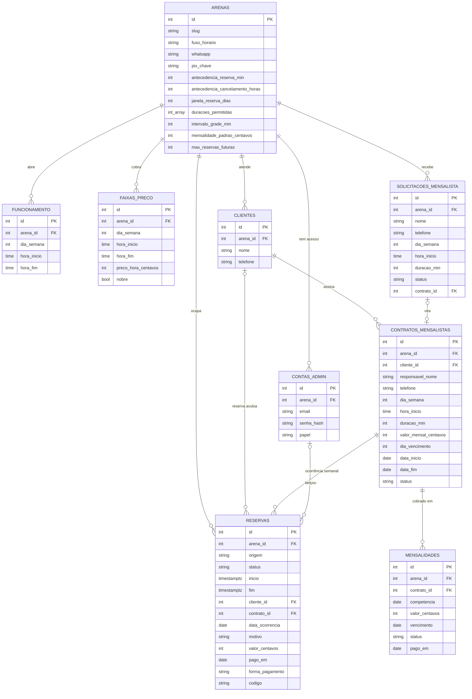

# Modelagem do banco de dados: Arena do Magrão

Banco **PostgreSQL 14+** (usamos o 18) com a extensão `btree_gist`. Segue o mesmo modelo
multi-tenant leve da barbearia: existe uma tabela `arenas`, todas as outras tabelas têm `arena_id`, e
as chaves estrangeiras compostas `(arena_id, id)` impedem misturar dados de arenas diferentes. Hoje só
existe a Arena do Magrão (`id = 1`, slug `arena-do-magrao`).

Arquivos:

- `database/schema.sql`: cria tudo (banco novo)
- `database/seed.sql`: dados iniciais da Arena (funcionamento e faixas de preço de exemplo)
- `database/NNN-*.sql`: atualizações para bancos que já existem (idempotentes)
- `database/lgpd/`: exportar e anonimizar os dados de um cliente

Regras de convenção:

- **Dinheiro em centavos (inteiro)**: toda coluna de valor termina em `_centavos`. R$ 150,00 = `15000`.
- **Instantes em `TIMESTAMPTZ`**, convertidos para o fuso da Arena (`arenas.fuso_horario`,
  `America/Sao_Paulo`) só na hora de mostrar ou de comparar com "hoje". Horário de relógio (funcionamento,
  contrato) em `TIME`.
- **Dia da semana**: `0 = domingo … 6 = sábado` (igual ao `EXTRACT(DOW ...)` do PostgreSQL).
- **Telefone**: só dígitos, com DDD e sem o 55 (`47999990000`).

---

## Diagrama



---

## A ideia central: tudo que ocupa a quadra está em `reservas`

A Arena tem uma quadra só. A quadra pode estar ocupada por três coisas:

| `origem` | O que é | Quem cria |
|---|---|---|
| `site` / `painel` | reserva avulsa | o cliente pelo site / o dono no painel |
| `mensalista` | a ocorrência de **uma semana** de um contrato (ex.: quarta 14/10, 20h–21h) | a API, a partir do contrato |
| `bloqueio` | manutenção, evento, torneio | o dono no painel |

Como as três ficam na mesma tabela, **uma única constraint** impede qualquer choque:

```sql
CONSTRAINT reservas_sem_sobreposicao
  EXCLUDE USING gist (arena_id WITH =, tstzrange(inicio, fim) WITH &&)
  WHERE (status = 'confirmada')
```

`tstzrange(inicio, fim)` é meio-aberto (`[inicio, fim)`): uma reserva até as 21:00 não bate com outra
que começa às 21:00. Se duas pessoas confirmarem o mesmo horário no mesmo instante, o PostgreSQL deixa
só a primeira gravar; a segunda recebe o erro `23P01`, que a API transforma em
**409 "Esse horário acabou de ser reservado"**.

Por que materializar as ocorrências em vez de calcular a agenda juntando contratos, exceções e
reservas: assim a regra fica num lugar só (o banco), a corrida entre uma avulsa e um mensalista é
barrada pela mesma constraint, e a consulta da agenda vira um `SELECT` simples por intervalo.

### Status de uma reserva

| `status` | Ocupa a quadra? | Quando |
|---|---|---|
| `confirmada` | **sim** | estado normal |
| `cancelada` | não | cliente ou dono cancelou; o horário volta a ficar livre |
| `liberada` | não | **exceção do mensalista**: não joga nesta data (feriado, viagem). A mensalidade não muda |
| `conflito` | não | ocorrência de mensalista que bateu com uma avulsa já marcada. Fica esperando o dono decidir quem fica |

`liberada` e `conflito` só existem em linhas de mensalista (há um `CHECK` para isso).

### Ocorrências de mensalista

- A API gera as ocorrências com a função idempotente `garantirOcorrencias` (`backend/src/ocorrencias.js`),
  sempre até um pouco além da janela de reserva avulsa. Ela roda ao ler a agenda, dentro da transação
  de reservar e ao criar, editar ou reativar um contrato. Por isso não depende de cron.
- `UNIQUE (contrato_id, data_ocorrencia)` garante **uma ocorrência por contrato por data**. Gerar de
  novo não duplica, e a exceção (`liberada`) sobrevive: a linha já existe, então não é recriada como
  `confirmada`.
- Se a data já tem uma avulsa confirmada no horário (por exemplo, o contrato foi criado depois da
  reserva), a ocorrência nasce como `conflito`. **Nenhuma reserva é apagada sozinha**: o dono escolhe no
  painel entre cancelar a avulsa ou deixar o mensalista sem jogar naquela data.
- Pausar ou encerrar um contrato apaga só as ocorrências **futuras** `confirmada`/`conflito`, que são
  dados derivados, e mantém as exceções. Reativar gera de novo.

---

## Tabelas

### `arenas`
O cliente do sistema e as configurações editáveis na aba **Configurações** do painel.

| Campo | Tipo | Observação |
|---|---|---|
| nome, slug | varchar | slug `arena-do-magrao` aparece na URL da API |
| fuso_horario | varchar | `America/Sao_Paulo` |
| whatsapp, instagram, endereco, link_mapa, pix_chave | varchar | NULL = ainda não informado; o site mostra `[PREENCHER]` |
| antecedencia_reserva_min | int | o site só aceita reserva que comece pelo menos X minutos depois de agora (120) |
| antecedencia_cancelamento_horas | int | o cliente cancela ou remarca até X horas antes (12) |
| janela_reserva_dias | int | até quantos dias à frente o site aceita reserva (30) |
| duracoes_permitidas | int[] | `{60,90,120}`: 1h, 1h30 ou 2h |
| intervalo_grade_min | int | de quantos em quantos minutos começam os horários (30) |
| mensalidade_padrao_centavos | int | sugerida ao cadastrar um mensalista |
| max_reservas_futuras | int | quantas reservas futuras o mesmo WhatsApp pode ter pelo site (3) |

### `funcionamento`
Horário de abertura por dia da semana. Dia sem linha = fechado; dois turnos no mesmo dia = pausa entre
eles. `hora_fim` pode ser `24:00`. A constraint `funcionamento_sem_sobreposicao` impede dois turnos
sobrepostos no mesmo dia.

| Dia | Exemplo do seed (a confirmar) |
|---|---|
| Segunda a sexta | 17:00–23:00 |
| Sábado e domingo | 08:00–22:00 |

### `faixas_preco`
Preço por hora conforme o dia e o horário. `nobre = true` marca o horário nobre (mostrado em amarelo no
site). A constraint `faixas_preco_sem_sobreposicao` impede faixas sobrepostas no mesmo dia, e a API exige
que as faixas cubram todo o funcionamento antes de salvar.

**Cálculo do preço** (`backend/src/precos.js`): minuto a minuto, cada minuto custa
`preco_hora_centavos / 60` da faixa em que está. Uma reserva de 1h30 das 18:30 às 20:00, com nobre a
partir das 19:00, custa 30 min do preço normal + 60 min do nobre. O total é arredondado para o centavo.

### `clientes`
Quem reserva ou é mensalista, identificado pelo WhatsApp (sem conta e sem senha). `telefone` é único
por arena. Ao anonimizar (LGPD), vira `removido-<id>`.

### `contas_admin`
Quem entra no painel. Senha sempre com bcrypt (criada por `npm run criar-admin`, nunca à mão no SQL).
`papel`: `dono` vê tudo; `funcionario` não vê faturamento nem configurações.

### `contratos_mensalistas`
O horário fixo semanal de um grupo.

| Campo | Observação |
|---|---|
| cliente_id | o responsável (criado ou atualizado pelo WhatsApp) |
| responsavel_nome, telefone | copiados na hora, como na barbearia |
| nome_grupo | opcional, ex.: "Turma da quarta" |
| dia_semana, hora_inicio, duracao_min | ex.: quarta, 20:00, 60 |
| valor_mensal_centavos | **fixo por mês**: mês com 5 quartas custa o mesmo |
| dia_vencimento | 1 a 28 (todo mês tem esse dia) |
| data_inicio, data_fim | `data_fim` NULL = sem prazo |
| status | `ativo`, `pausado`, `encerrado` |

**Constraint `contratos_sem_sobreposicao`:**

```sql
EXCLUDE USING gist (
  arena_id WITH =, dia_semana WITH =,
  int4range(minutos_do_dia(hora_inicio), minutos_do_dia(hora_inicio) + duracao_min) WITH &&,
  daterange(data_inicio, data_fim, '[]') WITH &&
) WHERE (status <> 'encerrado')
```

Dois contratos não encerrados nunca ficam no mesmo dia da semana com horários que se cruzam **em
períodos que se cruzam**. Um contrato que termina em dezembro e outro que começa em janeiro no mesmo
horário podem coexistir. **Pausado continua segurando a vaga**; para passar o horário para outro grupo,
o dono encerra o contrato. `minutos_do_dia(time)` é uma função `IMMUTABLE` do schema que converte
`20:30` em `1230`. Um `CHECK` impede o contrato de atravessar a meia-noite.

### `solicitacoes_mensalista`
O formulário "Quero ser mensalista" do site. **Não reserva nada.** O dono aprova (vira um contrato, e
`contrato_id` é preenchido) ou recusa. O `CHECK` garante que só a aprovada tem contrato.
`aceite_privacidade_em` registra quando a pessoa aceitou a política.

### `reservas`
Explicada acima. Campos por origem (garantidos por `CHECK`):

| Campo | Avulsa (`site`/`painel`) | `mensalista` | `bloqueio` |
|---|---|---|---|
| cliente_nome / cliente_telefone | obrigatório / site obrigatório | vazio (vem do contrato) | vazio |
| cliente_id | quando tem WhatsApp | vazio | vazio |
| contrato_id, data_ocorrencia | vazio | **obrigatório** | vazio |
| motivo | – | motivo da exceção | **obrigatório** (ex.: "Torneio") |
| valor_centavos | preço calculado na hora | 0 (cobrado na mensalidade) | 0 |
| pago_em, forma_pagamento | o painel marca como pago | – | – |
| codigo | código da reserva (`site`) | – | – |

O **código da reserva** tem 10 caracteres Crockford base32 (sem I, L, O e U, que confundem), sorteados
com `crypto.randomBytes` (50 bits). O cliente vê `Nº 128 · K7QM-2XPA-9F`. Para consultar, cancelar ou
remarcar, precisa do número **e** do código. A consulta tem limite de tentativas por IP.

`pago_em` e `forma_pagamento` andam juntos (`CHECK`) e só existem em reserva avulsa. Formas: `pix`,
`dinheiro`, `cartao`.

### `mensalidades`
Uma por contrato por mês.

| Campo | Observação |
|---|---|
| competencia | primeiro dia do mês (`CHECK (EXTRACT(DAY FROM competencia) = 1)`) |
| valor_centavos | copiado do contrato ao gerar; o dono pode ajustar enquanto estiver pendente |
| vencimento | `competencia + (dia_vencimento - 1)` |
| status | `pendente`, `paga`, `cancelada` |
| pago_em, forma_pagamento | obrigatórios quando `paga` (`CHECK`) |

- **`UNIQUE (contrato_id, competencia)`** torna a geração idempotente:
  `npm run gerar-mensalidades` e o botão do painel usam `INSERT ... ON CONFLICT DO NOTHING`, então rodar
  duas vezes não duplica.
- **Atrasada não é gravada.** É calculada: `status = 'pendente'` e `vencimento < hoje` (no fuso da
  Arena). Assim nenhum job diário precisa trocar o status, e a resposta da API traz
  `situacao`: `pendente`, `atrasada`, `paga` ou `cancelada`. O painel destaca as atrasadas, mas não
  bloqueia o contrato sozinho.
- Geradas para contratos `ativo` cujo período cruza o mês. Contrato pausado não gera; o dono decide.

---

## Regras garantidas pelo próprio banco

1. **Sem choque na quadra:** `reservas_sem_sobreposicao` (avulsa × avulsa, avulsa × mensalista,
   qualquer coisa × bloqueio, inclusive em cliques simultâneos).
2. **Sem dois mensalistas no mesmo horário:** `contratos_sem_sobreposicao`.
3. **Uma ocorrência por contrato por data:** `reservas_ocorrencia_unica`.
4. **Uma mensalidade por contrato por mês:** `mensalidades_uma_por_mes`.
5. **Configuração coerente:** turnos e faixas de preço sem sobreposição no mesmo dia.
6. **Isolamento entre arenas:** FKs compostas `(arena_id, ...)`.
7. **Valores válidos:** `CHECK` em status, origem, forma de pagamento, papel, valores não negativos,
   `fim > inicio`, campos coerentes com a origem.

---

## Consultas principais

**Agenda da semana** (painel; o site usa a mesma consulta sem nomes):

```sql
SELECT r.id, r.origem, r.status, r.inicio, r.fim,
       COALESCE(r.cliente_nome, c.nome_grupo, c.responsavel_nome) AS quem,
       r.valor_centavos, r.pago_em, r.motivo
  FROM reservas r
  LEFT JOIN contratos_mensalistas c ON c.id = r.contrato_id
 WHERE r.arena_id = $1
   AND r.status IN ('confirmada', 'conflito')
   AND r.inicio < $3 AND r.fim > $2          -- intervalo da semana
 ORDER BY r.inicio;
```

**Mensalidades do mês com situação:**

```sql
SELECT m.*, CASE WHEN m.status = 'pendente'
                  AND m.vencimento < (now() AT TIME ZONE $3)::date
                 THEN 'atrasada' ELSE m.status END AS situacao
  FROM mensalidades m
 WHERE m.arena_id = $1 AND m.competencia = $2;
```

---

## Como rodar localmente

```sql
\encoding UTF8
CREATE DATABASE arena_magrao;
\c arena_magrao
\encoding UTF8
\i 'C:/caminho/para/arena_magrao/database/schema.sql'
\i 'C:/caminho/para/arena_magrao/database/seed.sql'
```

`\dt` deve listar **8 tabelas**.

---

## Fica para depois

| O quê | Quando |
|---|---|
| cardápio e pedidos da cozinha | fora desta versão: o site só menciona que existe |
| inscrição de equipes em torneios | por enquanto pelo WhatsApp; o dia do torneio entra como bloqueio |
| pagamento online (gateway) | fora desta versão: Pix ou no local, o painel marca como pago |
| log de mensagens de WhatsApp enviadas | quando houver envio automático |
